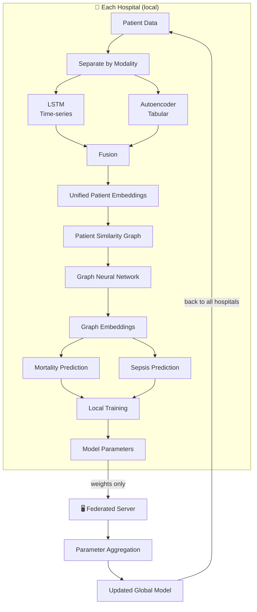

<div align="center">

# 🏥 Federated Multimodal Graph Learning Framework

### Mortality & Sepsis Prediction using the eICU Dataset

*Privacy-preserving, multi-hospital, multimodal, graph-enhanced clinical prediction*


</div>

> **Historical note (original specification).** This page is the project's original high-level
> specification and is kept as a record. The implemented, corrected project differs: it predicts
> **in-hospital mortality and ICU mortality** (`hospital_expired`, `icu_expired`) from the **first 24 h**
> of the ICU stay (six 4-hour bins), uses **tabular + time-series** inputs only (no clinical-text encoder),
> has **no sepsis head**, and compares FedAvg + GNN with a **No-GNN ablation and local-only baselines**
> (no centralized all-data baseline). It reports AUROC, AUPRC, F1 and Brier rather than accuracy.
> See [README.md](README.md) for the current scope, results and the synthetic viva demo.

---

## 📑 Table of Contents

1. [Objective](#-objective)
2. [Framework at a Glance](#-framework-at-a-glance)
3. [Step 1 — Data Preparation](#step-1--data-preparation)
4. [Step 2 — Modality-specific Feature Learning](#step-2--modality-specific-feature-learning)
5. [Step 3 — Multimodal Fusion](#step-3--multimodal-fusion)
6. [Step 4 — Intra-hospital Patient Graph Construction](#step-4--intra-hospital-patient-graph-construction)
7. [Step 5 — Graph Representation Learning](#step-5--graph-representation-learning)
8. [Step 6 — Multi-task Prediction](#step-6--multi-task-prediction)
9. [Step 7 — Federated Learning (Client Side)](#step-7--federated-learning-client-side)
10. [Step 8 — Central Server](#step-8--central-server)
11. [Overall Workflow](#-overall-workflow)
12. [Deliverables](#-deliverables)
13. [Future Improvements](#-future-improvements)

---

## 🎯 Objective

Design a **federated learning framework** that predicts **in-hospital mortality** and **sepsis** using **multimodal patient data** from the **eICU dataset**.

- Each **hospital** acts as an independent **federated client**.
- **Patient data never leaves the hospital.**
- Only **model parameters** are shared with a central server.

---

## 🧭 Framework at a Glance

| Component | Choice |
|---|---|
| **Federated client** | One hospital (identified by `hospitalid` in eICU) |
| **Modalities** | Time-series · Tabular |
| **Time-series encoder** | LSTM *(GRU / Transformer in future versions)* |
| **Tabular encoder** | Autoencoder *(or MLP)* |
| **Fusion** | Concatenation *(attention / gated fusion later)* |
| **Patient graph** | k-NN or thresholded cosine similarity, **within** each hospital |
| **Graph model** | GraphSAGE, GAT, or GCN |
| **Prediction tasks** | Mortality + Sepsis (multi-task) |
| **Aggregation** | FedAvg *(initially)* |
| **What is shared** | Model parameters (weights) **only** |

---

## Step 1 — Data Preparation

For each hospital (identified using the `hospitalid` field in the eICU dataset):

1. Collect all patients belonging to that hospital.
2. Divide the patient data into **two modalities**:

| Modality | Contents |
|---|---|
| ⏱️ **Time-series data** | Vital signs, laboratory measurements, physiological signals collected over time |
| 📋 **Tabular data** | Demographics, admission information, diagnosis codes, severity scores, etc. |

> 🔒 **Each hospital performs all preprocessing locally.**

---

## Step 2 — Modality-specific Feature Learning

Each modality is processed using a **separate encoder**, and each encoder learns a compact representation of the patient's information.

| Encoder | Model | Input | Output |
|---|---|---|---|
| ⏱️ **Time-series** | LSTM *(or GRU / Transformer in future versions)* | Sequential physiological measurements | Temporal embedding for each patient |
| 📋 **Tabular** | Autoencoder *(or an MLP)* | Structured clinical variables | Latent tabular embedding |

---

## Step 3 — Multimodal Fusion

The embeddings from the two encoders are combined to obtain a **unified patient representation**. Initially, simple **concatenation** can be used.

```text
Time-series Embedding  +  Tabular Embedding
                      │
                      ▼
          Unified Patient Embedding
```

> 💡 An **attention-based** or **gated fusion** module can later replace simple concatenation.

---

## Step 4 — Intra-hospital Patient Graph Construction

Using the unified patient embeddings, construct a **patient similarity graph within each hospital**.

**Possible approaches**

- **k-Nearest Neighbour (k-NN)**
- **Cosine similarity** with a predefined threshold

**Graph definition**

| Element | Definition |
|---|---|
| **Node** | One patient |
| **Edge** | Connects patients with similar clinical characteristics |
| **Cross-hospital edges** | ❌ None — no edges are created between patients from different hospitals |

---

## Step 5 — Graph Representation Learning

Train a **Graph Neural Network** (GraphSAGE, GAT, or GCN) on the patient graph.

| | |
|---|---|
| **Input** | Patient graph + unified patient embeddings |
| **Output** | Graph-enhanced patient embeddings |

The GNN captures **relationships among clinically similar patients**.

---

## Step 6 — Multi-task Prediction

Attach **two prediction heads** to the GNN output:

| Task | Target |
|---|---|
| **Task 1** | Mortality Prediction |
| **Task 2** | Sepsis Prediction |

The entire local model — **encoders + fusion + GNN + prediction heads** — is trained **jointly** using a **multi-task loss**.

---

## Step 7 — Federated Learning (Client Side)

Each hospital acts as one federated client. The local workflow is:

1. **Receive** the current global model from the server.
2. **Train** the complete model using only local hospital data.
3. **Update** all model parameters.
4. **Send** only the updated model parameters (weights) to the central server.

> ⚠️ **Important:** Raw patient data, embeddings, and graphs are **never shared**.

---

## Step 8 — Central Server

- The server receives model parameters from all participating hospitals.
- It performs **federated aggregation** (e.g., **FedAvg** initially) to produce an updated global model.
- The updated global parameters are sent back to **every hospital** for the next training round.
- The server **never has access to patient records**.

---

## 🔄 Overall Workflow



---

## 📦 Deliverables

The implementation should include:

### Core implementation

- [x] Data preprocessing pipeline
- [x] Two modality-specific encoders (Tabular & Time-series)
- [x] Multimodal fusion module
- [x] Patient graph construction algorithm
- [x] Graph Neural Network implementation
- [x] Multi-task prediction module
- [x] Federated learning pipeline
- [x] Training and evaluation scripts

### Baseline comparisons

| Baseline | Description |
|---|---|
| 🏠 **Local model only** | Each hospital trains in isolation |
| 🏛️ **Centralized model** | All data pooled in one place |
| 🌐 **Federated model (FedAvg)** | Proposed approach |

### Performance metrics

| Metric | Required |
|---|:---:|
| AUROC | ✅ |
| AUPRC | ✅ |
| Accuracy | ✅ |
| Precision | ✅ |
| Recall | ✅ |
| F1-score | ✅ |
| Calibration | ➖ *(optional)* |

---

## 🚀 Future Improvements

After obtaining a working implementation, the following enhancements can be explored:

| # | Current | → | Planned enhancement |
|:-:|---|:-:|---|
| 1 | Concatenation fusion | → | **Attention-based multimodal fusion** |
| 2 | FedAvg | → | **Personalized or adaptive federated aggregation** |
| 3 | Static similarity graphs | → | **Dynamic temporal patient graphs** |
| 4 | Black-box predictions | → | **Explainability** via GNNExplainer or attention visualization |
| 5 | Point predictions | → | **Uncertainty estimation and model calibration** |

---

<div align="center">

*Federated Multimodal Graph Learning Framework · Mortality & Sepsis Prediction · eICU*

</div>
