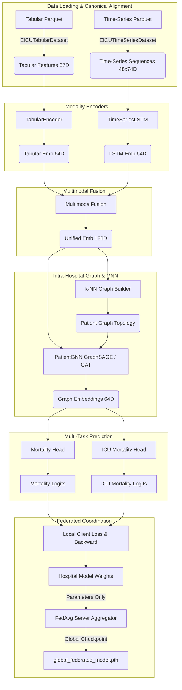

# 🏥 Federated Multimodal Graph Learning Framework - Core Pipeline Documentation

> Current scope: in-hospital and ICU mortality from the first 24 h of the ICU stay (patients still in the
> ICU at 24 h), tabular + time-series inputs, hospital-level train/val/test split. See [README.md](README.md)
> for commands, results and the synthetic demo.

This document serves as the developer guide and architectural overview for the end-to-end pipeline (Steps 1 through 8) and baseline benchmarking suite of the Federated Multimodal Graph Learning Framework on the eICU dataset.

## 🏗️ Architecture Overview

The pipeline transforms raw hospital `.parquet` files into an intra-hospital graph of patients and collaboratively learns prediction models without sharing patient records across hospital boundaries.



---

## 🛠️ Components Breakdown

### Step 1: Data Preparation (`src/datasets.py`)
- **`EICUTabularDataset`**: Reads `tabular_features.parquet`. Aligns to 67 canonical features, imputing unobserved features with 0.0 and applying z-score scaling.
- **`EICUTimeSeriesDataset`**: Reads `timeseries_features.parquet`. Aligns hourly data to 74 canonical continuous clinical features (padding/truncating to 48 hours).
- **Canonical Standardization**: Pre-extracted in `processed/canonical_tabular_features.json` and `processed/canonical_timeseries_features.json` to guarantee identical parameter shapes across all 207 hospitals.

### Step 2: Modality-specific Encoders (`src/encoders.py`)
- **`TabularEncoder`**: 3-layer MLP mapping 67 static features $\to$ 64D embedding with LayerNorm, Dropout, and ReLU activations.
- **`TimeSeriesLSTM`**: 2-layer LSTM with `pack_padded_sequence` projecting variable-length 74D time series $\to$ 64D temporal embedding.

### Step 3: Multimodal Fusion (`src/fusion.py`)
- **`MultimodalFusion`**: Concatenates Tabular (64D) + Time-Series (64D) $\to$ 128D vector, passing through projection layers with LayerNorm and Dropout to yield a unified patient representation.

### Step 4: Intra-hospital Graph Construction (`src/graph_builder.py`)
- **`build_knn_graph`**: Uses Cosine or Euclidean distance to connect each patient to their top-$k$ nearest neighbors ($k=5$) within the same hospital.
- **Privacy Guarantee**: All edges are strictly intra-hospital. **No cross-hospital edges are ever constructed**, mathematically ensuring data compartmentalization.

### Step 5: Graph Representation Learning (`src/gnn.py`)
- **`PatientGNN`**: Supports **GraphSAGE**, **GAT** (Graph Attention Networks with multi-head attention), and **GCN**.
- Incorporates residual skip connections, batch normalization, and safe fallbacks for edge-less single-patient graphs.

### Step 6: Multi-task Prediction & End-to-End Model (`src/models.py`)
- **`MultiTaskPredictionHeads`**: Dual heads predicting in-hospital mortality (`hospital_expired`) and ICU mortality (`icu_expired`).
- **`FederatedPatientModel`**: Single end-to-end PyTorch module wrapping Encoders $\to$ Fusion $\to$ Graph Builder $\to$ GNN $\to$ Heads.
- **`MultiTaskLoss`**: Weighted loss combining binary cross-entropy with `pos_weight=3.0` to address ICU outcome class imbalance.
- **`src/metrics.py`**: Clinical metrics including AUROC, AUPRC, F1-Score, Precision, Recall, Specificity, and Brier calibration score.

### Steps 7 & 8: Federated Training Orchestrator (`scripts/train_federated.py`)
- **Client Training**: Simulates hospital clients training locally using private patient graphs. Caps local steps per round to prevent large-hospital dominance.
- **Server Aggregation**: Samples hospital clients per communication round and executes sample-weighted FedAvg parameter aggregation.
- **Checkpoints**: Saves the best global model (lowest validation loss) to `<out dir>/global_federated_model.pth` with `training_history.json` and `run_info.json`; new runs default to `results/rerun/`. `results/corrected/` holds the recorded runs and is never written to.

### Baseline Benchmarking Suite (`scripts/benchmark_baselines.py`)
- Compares:
  1. **Local-Only Hospital Model**: Trains in isolation on a single hospital without federation.
  2. **Multimodal No-GNN Ablation**: Tabular + Time-Series without graph patient similarity.
  3. **Federated Multimodal Graph Model (FedAvg)**: Proposed privacy-preserving collaborative framework.
- Every model is trained by `scripts/train_federated.py` (local-only = `--train-hospitals`); the benchmark only evaluates the saved checkpoints on the 31 held-out **test** hospitals and writes `<results dir>/benchmark_results.json`.

---

## 🚀 Execution Commands

Windows PowerShell, from the project root, after the setup in [README.md](README.md). Steps 1-2 need
the prepared eICU hospital Parquet files in `processed/hospitals/`; without them they stop with an explanation.

### 1. Run Federated Training
```powershell
.\.venv\Scripts\python.exe scripts\train_federated.py --rounds 50 --clients-per-round 10 --out-dir results\rerun\fedavg_gnn\seed42
```

### 2. Run all experiments and the benchmark
```powershell
.\.venv\Scripts\python.exe scripts\run_experiments.py --out-root results\rerun
```

### 3. Run Test Suite
```powershell
.\.venv\Scripts\python.exe -m pytest tests -q
```
